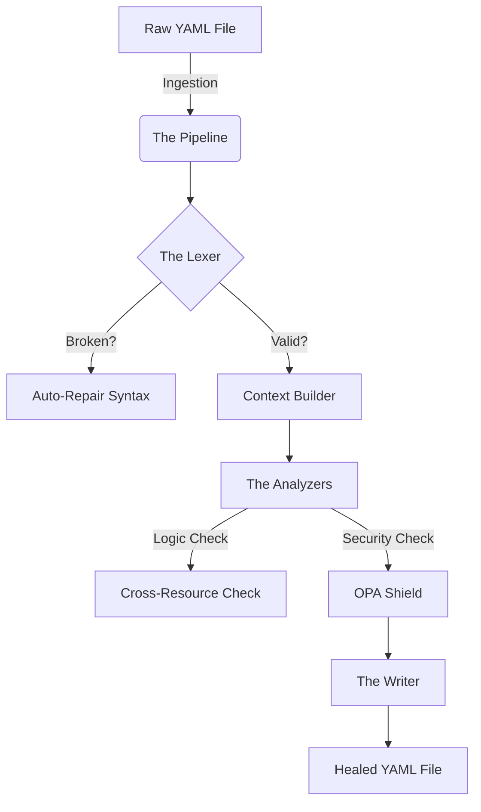

# 🗺️ Yamlr System Architecture (The Founder's Map)
**"How it Works" for Non-Technical Stakeholders**

> **The Golden Rule of Debugging:** You don't need to fix the code. You just need to know **WHICH** file is broken so you can tell an engineer (or AI) where to look.

---

## 🏭 Part 1: The "Factory" Analogy
Think of Yamlr not as code, but as a **Recall & Repair Factory**.

1.  **Ingestion (The Loading Dock):** Trucks (Files) arrive. We check them in.
2.  **The Assembly Line (The Pipeline):** We open the box, check the contents, and fix broken parts.
3.  **Quality Control (The Analyzers):** Inspectors check if the product matches the blueprint.
4.  **Security (The Shield):** Security guards check for contraband.
5.  **Packaging (The Writer):** We repack the box and ship it.

---

## 📂 Part 2: The Staff Directory (File Glossary)
*Who does what, and when to blame them.*

### The Management (Core)
| File | Role | Analogy | When to Blame |
| :--- | :--- | :--- | :--- |
| `src/yamlr/core/manager.py` | **The Infrastructure Lead** | Handles FS I/O, Catalog fallbacks, and Worker Pools. | If global config or file access fails. |
| `src/yamlr/core/engine/base.py` | **The Factory Manager** | Orchestrates high-level scan/heal loop; delegates to specialists. | If the tool crashes *before* starting the pipeline. |
| `src/yamlr/core/engine/telemetry_handler.py` | **The Statistician** | Calculates incident ranks and recording session-level metrics. | If the summary stats are wrong or missing. |
| `src/yamlr/core/engine/policy_factory.py` | **The Policy Liaison** | Initializes OPA and Kyverno adapters for enterprise rules. | If OPA/Kyverno rules are not loading. |
| `src/yamlr/core/engine/surgery_pool.py` | **The Foreman** | Manages parallel workers and Zero-Deadlock Windows execution. | If parallel scans hang or crash on Windows. |
| `src/yamlr/core/engine/auditor.py` | **The Quality Inspector** | Analyzes individual files and streams for semantic violations. | If a specific file's findings are missing. |
| `src/yamlr/core/engine/processor.py` | **The Production Line** | Manages batch processing and high-level result aggregation. | If batch results are inconsistent or missing. |
| `src/yamlr/core/engine/security.py` | **The Security Detail** | Enforces hostPath policies and enterprise security guardrails. | If path-traversal or hostPath issues are missed. |
| `src/yamlr/core/pipeline.py` | **The Assembly Line** | Executes discrete **Stages** (Lexer -> Validator -> Healer). | If the process fails *during* a single file audit. |
| `src/yamlr/core/config.py` | **The Rulebook** | Reads `.yamlr.yaml` for ignore patterns and defaults. | If it's scanning files it should ignore (like `.git`). |
| `src/yamlr/core/exceptions.py` | **The Diagnostic Center** | Base hierarchy for high-fidelity errors. | If an error message is vague or lacks a "Surgeon's Hint". |

### The Specialists (Parsers)
| File | Role | Analogy | When to Blame |
| :--- | :--- | :--- | :--- |
| `src/yamlr/core/lexer.py` | **The Translator** | Reads raw text. Handles "Round Trip" (Comments). | If Yamlr **deletes your comments**. |
| `src/yamlr/parsers/structurer.py` | **The Architect** | Rebuilds the YAML tree structure. | If nesting or list indentation is wrong. |
| `src/yamlr/parsers/physicist.py` | **Indentation Physics** | Pure stack-based indentation resolution. | If items pop out of lists incorrectly. |
| `src/yamlr/parsers/schema_healer.py` | **Restoration Intel** | Schema-aware type and array detection. | If a map should be a list (or vice versa). |
| `src/yamlr/core/migrator.py` | **The Time Traveler** | Knows old K8s APIs and how to upgrade them. | If it fails to upgrade `v1beta1` to `v1`. |

### The Inspectors (Analyzers)
| File | Role | Analogy | When to Blame |
| :--- | :--- | :--- | :--- |
| `src/yamlr/analyzers/cross_resource.py` | **The Detective** | Connects dots between files (Service -> Pod). | If a cross-resource link is missed. |
| `src/yamlr/analyzers/detectors.py`| **Relationship Sensors** | Core logic for Ghost Services/Orphan Configs. | If a specific relationship logic is flawed. |
| `src/yamlr/analyzers/network_logic.py` | **Network Inspector** | Validates Ports, Ingress, and Backend refs. | If a port mismatch is missed. |
| `src/yamlr/analyzers/best_practices.py` | **The Safety Inspector** | Checks for standard safety rules (Root user, Limits). | If it says "Image tag missing" but it's there. |
| `src/yamlr/core/bridge.py` | **Capability Bridge** | Coordinates OSS vs Pro features. | If features aren't discovered correctly. |
| `src/yamlr/core/license_manager.py` | **The Guard** | Handles Pro license status and notifications. | If license warnings are noisy or incorrect. |
| `src/yamlr/pro/opa_adapter.py` | **The Customs Agent** | Checks external corporate policies. | If OPA policies are ignored. |

---

## 🔧 Part 3: The "Decision Tree" for Debugging
*Use this flow when something goes wrong.*

**Scenario A: "It crashed!" (Python Traceback)**
1.  Look at the **last line** of the error. Every failure now includes a **"Surgeon's Hint"**.
2.  Does it say `YamlrSecurityError`? -> Blame `security.py` (Security Anchor).
3.  Does it say `YamlrParseError`? -> Blame `lexer.py` (Broken YAML).
4.  Does it say `YamlrEngineError`? -> Blame `pipeline.py` (Logic Crash).

**Scenario B: "It broke my file!" (Data Loss)**
1.  **STOP.** Do not run it again.
2.  The culprit is almost always **`src/yamlr/core/lexer.py`**.
3.  *Instruction to Engineer:* "The Round-Trip Lexer failed to preserve comments on line X."

**Scenario C: "It missed a bug!" (False Negative)**
1.  Which *type* of bug?
2.  **syntax error?** -> Blame `pipeline.py`.
3.  **Ghost Service?** -> Blame `cross_resource.py`.
4.  **Security issue?** -> Blame `best_practices.py`.

---

## 🧠 Part 4: Founder Strategy (How to NOT code)
As a non-technical founder, your job is **Isolation**, not Fixing.

1.  **Reproduce:** Can you make it happen again with a small file?
2.  **Identify:** Use the table above to find the *suspect file*.
3.  **Delegate:**
    *   *Bad Ticket:* "Yamlr is broken."
    *   *Good Ticket:* "The `CrossResourceAnalyzer` in `analyzers/cross_resource.py` is failing to detect Services in the `prod` namespace."

**Why this works:**
Engineers (and AI) waste 80% of their time *finding* the code. If you point them to `cross_resource.py`, you save 80% of the cost.
