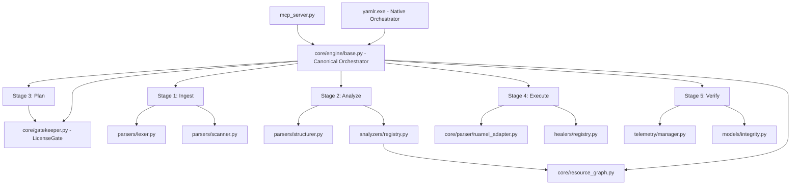

# 🗺️ Yamlr Architectural Mental Model
**"The Autonomous Manifest Control Plane"**

This document outlines the core patterns and high-level logic that drive Yamlr's unique healing capabilities.

---

## 🏗️ 1. The Unified 5-Macro-Stage Engine
Yamlr has consolidated its 18+ legacy stages into a single, canonical orchestrator (`YamlrEngine`) driven by a deterministic dataflow.

| Macro-Stage | Component | Responsibility | DNA Focus |
| :--- | :--- | :--- | :--- |
| **1. Ingest** | `lexer.py` / `scanner.py` | Lexical repair, Sharding, and Identity anchoring. | Physical |
| **2. Analyze** | `structurer.py` / `analyzers/` | Multi-dimensional schema & semantic violation detection. | Knowledge |
| **3. Plan** | `engine/base.py` | Tier-aware strategy generation and risk assessment. | Policy |
| **4. Execute** | `ruamel_adapter.py` / `healers/` | Surgical repairs with 100% comment preservation. | Semantic |
| **5. Verify** | `gatekeeper.py` / `stats.py` | Forensic verification, DNA Scoring, and ROI tracking. | Trust |

---

---

## 🧠 2. Core Design Patterns

### A. Sovereign Key Pattern
In corrupt YAML, identity markers (like `kind` or `apiVersion`) are often incorrectly indented. Yamlr identifies the "shallowest" candidates for these keys and promotes them to the root identity, allowing identification even when a standard parser fails with `IndentationError`.

### B. Indentation Physics
Yamlr does not use a standard DOM-based parser for healing. Instead, it uses a **Vertical Scope Stack**. As shards stream through the engine, we track the "pressure" of indentation to determine logical parentage, much like how a human eye scans code.

### C. Semantic DNA Integrity
To ensure "Yamlr Never Breaks Production," we calculate a hash of the manifest's *semantic meaning* before and after healing. If the healing logic accidentally changes a value or a nested structure (that wasn't part of a fix), the DNA hash will mismatch, and the write operation is blocked.

---

## 🔗 3. Safety Engine Layer (2026-02)

### A. ResourceGraph (`core/resource_graph.py` + `core/edges/`)

Models cross-resource dependencies as a directed graph with **17 typed edge types**:

```
               ┌─────────────┐
               │  EdgeType   │
               ├─────────────┤
  Config ──────│ CONFIGMAP   │  Volume/Env bindings
  Config ──────│ SECRET      │  Volume/Env bindings
  Config ──────│ PVC         │  Storage claims
  Config ──────│ SA          │  ServiceAccount bindings
  Traffic ─────│ SVC_SELECT  │  Service → Pod selectors
  Traffic ─────│ INGRESS_BE  │  Ingress → Service backends
  Traffic ─────│ GATEWAY_RT  │  HTTPRoute → Service backends
  Owner ───────│ OWNER_REF   │  Deployment → ReplicaSet chains
  Scheduling ──│ TOLERATES   │  Pod ↔ Node tolerations
  Scheduling ──│ NODE_SELECT │  Pod → Node affinity
  Scheduling ──│ PRIORITY_CL │  Pod → PriorityClass
  Scheduling ──│ RUNTIME_CL  │  Pod → RuntimeClass
  Security ────│ NET_POLICY  │  NetworkPolicy → Pod targets
  Disruption ──│ PDB_TARGET  │  PDB → Pod targets
  CRD ─────────│ CRD_INST   │  Custom resource → CRD definition
  Init ────────│ INIT_CONT  │  Init container → shared volumes
  HPA ─────────│ HPA_TARGET │  HPA → scalable targets
               └─────────────┘
```

**Key methods:** `build()`, `dependents()`, `dependencies()`, `blast_radius()`, `critical_path()`.

Architecture: Edge-building logic is modularized into the `yamlr.core.edges` package with specialized collectors for standard K8s resources, network logic, and security policies. `resource_graph.py` handles graph structure and traversal.

### B. Risk Classifier (`analyzers/risk_classifier.py`)

**Connective Tissue Warning:** The `RiskClassifier` is tightly coupled with `CrossResourceAnalyzer` (which feeds it findings) and `ResourceGraph` (which it queries to determine blast radius and cascading impact scores).

Heuristic-based risk assessment engine with **15 risk categories** and **14 scoring rules**.

| Category | Scope | Risk Level |
|:---------|:------|:-----------|
| Traffic Routing Failure | Cluster | HIGH |
| Data Dependency Failure | Namespace | MEDIUM |
| API Deprecation Risk | Cluster | HIGH |
| Orphan Configuration Waste | Namespace | LOW |
| Security Policy Violation | Cluster | HIGH |
| Scheduling Configuration Risk | Namespace | MEDIUM |
| Network Isolation Risk | Cluster | HIGH |
| Disruption Tolerance Risk | Namespace | MEDIUM |
| Image Pull Failure Risk | Namespace | HIGH |
| CRD Dependency Risk | Namespace | MEDIUM |
| Replica Configuration Risk | Namespace | MEDIUM |

**Scoring heuristics prioritize:** NetworkPolicy/Image → always HIGH (security/availability). Orphans → always LOW. Everything else → context-dependent.

### C. Version Intelligence (`core/k8s_versions.py` + `deprecations.py`) [v1.6]
- **SSOT Matrix**: Centralized authority for min/max/default K8s versions.
- **Dynamic Context Binding**: Pipelines re-bind to specific version DNA per-manifest to prevent **Version Leakage** in batch runs.
- **Stability Gates**: Universal interactive guards for Alpha/Beta/RC versions.
- **Adaptive Compatibility**: Intelligent fallback to the nearest supported stable catalog if a specific version is unavailable.
- **Distilled DNA**: Uses lightweight (<1MB) pre-filtered catalogs instead of 30MB+ raw swagger files, enabling sub-millisecond lookups.
- **Automated Pruning**: Built-in cache maintenance (30-day TTL) to optimize binary footprint for M&A readiness.
- `upgrade_risk_score()`: Version-aware risk quantification for API migrations (v1.9 → v1.35).

---

## 📊 4. Visual Hooks & Strategic Observability (v1.3)

### A. Relational Topology (`yamlr graph`)
Yamlr's graph engine enables multi-dimensional dependency mapping:
- **Topology**: Structural connections (Service → Pod → Volume).
- **Blast Radius**: Impact analysis of a theoretical failure or change.
- **Visual Exports**: Seamless Mermaid/ASCII/JSON output for documentation and architecture reviews.

### B. Application-Centric Safety (`yamlr stats --apps`)
Unlike traditional scanners that report on files, Yamlr (v1.3+) aggregates findings into **logical applications**.
- **Blast Radius Multiplier**: Weighting mission-critical apps higher in safety scores.
- **ROI Tracking**: Measuring "Man-Hours Saved" through automated surgical healing.

### C. IDP & Prometheus Integration (`yamlr idp-export`)
Bridging the gap between the local CLI and enterprise visibility:
- **Backstage**: Native Catalog-Info generation with safety metadata.
- **Prometheus**: Metric scraping for real-time cluster hygiene monitoring.

---

## 🛡 4. Modularity Guardrails
Yamlr enforces a strict **< 500 line per module** rule. 

- **Infrastructure**: Managed by `YamlrManager` (I/O, Catalog, Context).
- **Orchestration**: Managed by `YamlrEngine` and `processor.py` (Parallel Batching, Global Analysis).
- **Specialization**: Logic is offloaded to modular helpers (`processor_helpers.py`, `crawler.py`, `scanner_heuristics.py`) to maintain < 500 lines per module.
- **CLI Help**: Decomposed into `cli/help/help_scan.py`, `help_heal.py`, `help_toolbox.py`, `help_utils.py`.
- **Graph Edges**: Modularized into `yamlr.core.edges` package to prevent `resource_graph.py` from becoming a God Object.

---

## 🧬 5. Cross-File Dependency Map (Hybrid Edition)



---

## ⚡ 6. Hybrid Orchestration (The "Elite" Distribution)

Since **Phase 6.1**, Yamlr has moved to a Hybrid model to ensure the project is **Acquisition Ready** ($150M+ target).

### A. The Orchestrator (Rust)
- **Role**: High-speed filesystem walking and "Initial Triage."
- **Why?**: Python is too slow for 1M+ file monorepos. Rust handles the I/O and embeds the Python engine as a Zstd-compressed payload.
- **Source Preservation**: The Rust scanner **emulates** the Python scanning logic. It does NOT replace it.

### B. The Surgical Worker (Python)
- **Role**: Deep healing, complex risk classification, and "Stage 4-10" logic.
- **Integrity**: **100% of the original Python logic is preserved.** No code was deleted. The Python scanning module (`scanner.py`) remains the "Source of Truth" and the "Gold Standard" for accuracy.

### C. The Parity Guard
To ensure `Zero-Failure Trust`, the system includes a `verify_rust_parity.py` utility. It verifies that the Rust Orchestrator’s discovery output matches the original Python Scanner’s output bit-for-bit.

---

## ⚡ 7. The Performance Paradox (Silent Killer)
Yamlr's scaling model uses a **Fork-Join Architecture** (Multiprocessing). 

1. **Phase 1: Analysis (Parallel)**: High throughput. Distributed across CPU cores.
2. **Phase 2: Global Resolution (Hyperscale Streaming)**: **RESOLVED BOTTLENECK**. Cross-resource reference resolution and stub healing are now parallelized using `joblib` (Round 4) and use **Generator-Based Streaming** (Round 12). 
    - **Impact**: On repos with >1M manifests, Phase 2 scales linearly without OOM risk by avoiding materialization of the entire workspace graph into memory.
3. **Phase 3: Fast-Path Native Extraction**: **118x Gain (Round 23)**. Rust-based metadata extraction enables 150 MB/s / 23k files/sec throughput on cold caches.

---

## 🚀 8. The "Magic Moment" Factory
Yamlr provides a zero-config entry point for developers:

```python
from yamlr.core.engine import YamlrEngine
engine = YamlrEngine.quick(".")
results = engine.batch_heal(".")
```

This factory leverages **Industrial-Grade Fallbacks**, including an embedded minimal catalog, to ensure a functional experience even in "asset-stripped" environments.

---

### D. Platform-Specific Safety (`tests/platform/test_os_specific.py`)
Ensures path normalization and encoding safety invariants are consistent across Windows and Linux, specifically addressing the "Path Injection" and "Encoding Mismatch" risks in terminal execution.

### E. Forensic Sovereign Taxonomy (SHD-001 - SHD-015)
The Shield Engine implements 15 critical forensic risk categories:
- **SECURITY**: Unsafe HostPath, Privileged Containers, Host Network, RBAC Escalation.
- **TRAFFIC**: Ingress Hijack, Traffic Misrouting.
- **AVAILABILITY**: Resource Starvation, Disruption Blind-Spots, HPA Replica Conflicts.
- **DATA**: Circular Dependencies, Sensitive Volume Exposure.
- **HYGIENE**: Zombie APIs, Orphan Bloat, CRD Version Drift.

---

## ⚡ 6. Cross-File Connective Tissue
Understanding how data flows between discrete engine components.

| Component | Input | Output | Connective Tissue |
| :--- | :--- | :--- | :--- |
| **Lexer** | `raw_text` | `List[Shard]` | Translates lines into shards; isoloates comments. |
| **Shadow** | `List[Shard]` | `Shard.layout_sequence` | Anchors Gaps/Comments to the nearest Data Shard. |
| **Scanner** | `List[Shard]` | `List[ManifestIdentity]` | Mines identity (Kind/v1) and tags intent (k8s.spec). |
| **Structurer**| `List[Shard]` | `List[YamlNode/dict]` | Reconstructs semantic hierarchy from linear shards. |
| **Healers** | `List[Doc]` | `List[Doc]` (Mutated) | High-level semantic repairs (Hardening, Probes). |
| **Serializer**| `List[Doc]` | `healed_text` | Round-trips docs back to text using Shadow metadata. |

---

## 🚀 7. The $20M Acquisition Readiness Audit
Yamlr is designed for maximum "Ingestability" by acquiring engineering teams.

- **Modularity**: < 500 lines per module.
- **Detached Logic**: The Engine can run headless (no CLI) for GitOps integrations.
- **Auditability**: Every change is tracked via `YamlrEvidence` and Semantic DNA hashes.
- **Zero-Failure Trust**: Heuristic safety gates prevent destructive writes.

---

## 🛰 9. The Agentic Safety Interface (MCP)
Since **Phase 9.1**, Yamlr exposes its internal safety engine via the **Model Context Protocol (MCP)**.

- **Transport**: JSON-RPC over `stdio` (deterministic, unbuffered).
- **Interface**: `mcp_server.py`.
- **Primary Tooling**:
    - `scan_manifest`: Returns `AnalysisResult` with **Conversational Rationale** and **Business Impact Analysis**.
    - `heal_manifest`: Allows agents to apply precise fixes without full CLI context.
    - `why`: Connects rule IDs to deep architectural safety justifications.

---

## 🛠 10. The Total Visibility Layer (v0.1.0-stable)

Yamlr's distribution is hardened for "Due Diligence Readiness" through three visibility pillars:

### A. Capability Discovery (`yamlr features`)
The `features` command serves as the living roadmap. It maps implemented internal logic (in `core/` and `pro/`) to a user-facing matrix, distinguishing between Community (Free) and Enterprise (Pro) tiers. This ensures no "Ghost Logic" exists—every capability is discoverable.

### B. Modular CLI Help Dispatch (`cli/help/`)
To maintain the **< 500 line modularity rule**, CLI help is decomposed into specialized modules. A centralized `help_formatter.py` acts as a thin dispatcher, ensuring that help text for 35+ commands never creates a monolithic file.
- **Dispatch Pattern**: `help_formatter.py` -> `help/help_scan.py`, `help_heal.py`, etc.

### C. Version Sovereignty (`version_helper.py`)
Centralizes versioning authority in a single script. For compiled binaries (Nuitka), Yamlr uses a **Frozen Fallback** pattern in `base.py` to ensure version reporting is deterministic even without a source `pyproject.toml`.

---

# 🏁 Summary
Yamlr is an autonomous safety engine for Kubernetes manifests, combining the speed of a Rust orchestrator with the surgical precision of a Python healing engine, and the total visibility of a modular CLI architecture. It is the "Safety intelligence Provider" for the next generation of AI-driven infrastructure, documented and distribution-hardened for immediate enterprise adoption.
