# 🧠 Yamlr Architectural Mental Model & Connective Tissue Graph

> **Authoritative Architectural Reference and Systems Engineering Specification.**

---

# 📖 The Yamlr Master Guide, Architecture Mental Model & Complete File Glossary

> **The Definitive Blueprint & Technical Architecture of the Yamlr Healing Engine**

---

## 🏛 1. Executive Overview: What is Yamlr? (For Non-Technical Leaders)

### The Real-World Metaphor: "Grammarly + Auto-Mechanic for Cloud Infrastructure"
Imagine you are building a skyscraper. Cloud engineers write instructions called **Kubernetes YAML manifests** telling Kubernetes clusters—across any public cloud (AWS EKS, Google Cloud GKE, Azure AKS) or private enterprise environment (on-prem, OpenShift, Talos, bare-metal)—how to deploy software, connect databases, and open network doors.

* **The Problem**: Over 60% of cloud outages (like when an app goes down at 2 AM) are caused by tiny typos in these YAML instructions—such as mismatched port numbers, missing security locks, or deprecated syntax.
* **The Traditional Tool Failure**: Existing linters (like Kubeconform or Checkov) act like angry inspectors: they point out 500 errors in red ink (alert fatigue) and refuse to let the building open, but **they do not fix anything**.
* **Yamlr's approach**: Yamlr scans Kubernetes manifests and offers repairs for supported findings. Review proposed changes and validate output, including comments and layout, before applying them.

```
┌────────────────────────────────────────────────────────────────────────────────────────┐
│                                   THE YAMLR MOAT                                       │
├───────────────────────────────┬────────────────────────────────────────────────────────┤
│ 1. Native Rust Execution      │ The CLI runs as a native Rust binary without Python.   │
│ 2. Preservation-Oriented Design│ Preserves source comments and layout where supported. │
│ 3. Autonomous Guardrail       │ Protects CI/CD pipelines, GitOps, and IDE workflows.   │
│ 4. Supplier Engine Model      │ Standardized core for platform tools & security suites.│
└───────────────────────────────┴────────────────────────────────────────────────────────┘
```

---

## 🗺 2. Architectural Mental Model: Connective Tissue Graph

This diagram visualizes how every component and file in Yamlr interconnects from developer input down to atomic binary mutations:

```mermaid
graph TD
    subgraph "1. Client & Trigger Layer (How Users & Tools Interact)"
        CLI_User["Developer Terminal (yamlr scan / heal)"]
        IDE_Ext["IDE & Editor Extensions (vscode/)"]
        MCP_Client["AI Coding Agents (Claude Desktop, Cursor, AGY via stdio MCP)"]
        GitOps_Argo["ArgoCD / Flux GitOps (integrations/argocd)"]
        Web_User["Web Browser Sandbox (website/src via WASM)"]
        PreCommit_Hook["Git Pre-Commit Hook (.pre-commit-config.yaml)"]
    end

    subgraph "2. Execution & Dispatch Plane (Native Rust / Ruff-Model Python Wrapper)"
        Native_Bin["native_core/src/bin/main.rs (Standalone Native yamlr executable)"]
        Py_Entry["src/yamlr/__main__.py (Ruff-Style Thin Python Wrapper)"]
        PyO3_Bridge["src/yamlr_native/ (PyO3 C-Extension Module)"]
        CLI_Dispatch["native_core/src/cli/dispatch.rs (62-Command Native Dispatcher)"]
        Support_Contract["native_core/src/cli/support_contract.rs (Clap Typed Parsers)"]
    end

    subgraph "3. Autonomous Resolution Core (native_core/src/)"
        Sharder["sharder.rs (Layout-Preserving Sharding & Tokenizer)"]
        Structurer["structurer.rs (Zero-Unsafe Arena Tree AST)"]
        Validator["schemas/validator.rs (OpenAPI v3 AST Schema Validator)"]
        NestedValidator["schemas/nested.rs (Deep JSON Pointer & CRD Validator)"]
        Constraints["schemas/constraints.rs (OpenAPI v3.1 Structural & Numeric Constraints)"]
        CEL["cel.rs (Kubernetes CEL x-kubernetes-validations Engine)"]
        AuditEngine["audit_engine.rs + audit_registry.rs (Forensic Cross-Resource Rules)"]
        Healers["healers/ (21 Focused Transformation Stages < 500 lines)"]
        WalStore["remediation_io/ (Atomic Rollback Store & WAL)"]
        Signer["security/ (HMAC-SHA256 Manifest Signer & Verifier)"]
    end

    CLI_User --> Native_Bin
    PreCommit_Hook --> Native_Bin
    GitOps_Argo --> Native_Bin
    Py_Entry --> Native_Bin
    Py_Entry -. fallback .-> PyO3_Bridge
    PyO3_Bridge --> CLI_Dispatch
    Native_Bin --> CLI_Dispatch
    MCP_Client --> CLI_Dispatch
    IDE_Ext --> CLI_Dispatch

    CLI_Dispatch --> Support_Contract
    CLI_Dispatch --> Sharder
    Sharder --> Structurer
    Structurer --> Validator
    Structurer --> NestedValidator
    Structurer --> Constraints
    Structurer --> CEL
    Structurer --> AuditEngine
    Structurer --> Healers
    Healers --> WalStore
    Structurer --> Signer
```



---

## 3. Step-by-Step End-to-End Workflows

### Workflow A: Clinical Read-Only Audit (`yamlr scan .`)
1. **Trigger**: Developer runs `yamlr scan .` in terminal or CI.
2. **Ingestion**: `scanner.py` crawls directory and identifies `.yaml` / `.yml` files.
3. **Lexing (Rust)**: `sharder.rs` breaks text into byte shards without stripping indentation or comments.
4. **Arena Construction**: `structurer.rs` builds an index-based semantic tree in memory (preventing memory corruption).
5. **Schema & Forensic Audit**: `schemas.rs` verifies official Kubernetes OpenAPI v3 specs while `audit_engine.rs` runs 42 relational checks (e.g. Service `targetPort` matching Deployment container ports).
6. **Reporting**: `formatters.py` prints the colorized Rich terminal report or emits SARIF 2.1.0 JSON for GitHub Security.

---

### Workflow B: Autonomous Surgical Auto-Repair (`yamlr heal . --apply`)
1. **Safety Checkpoint**: `backups.py` takes an instant snapshot of target files in `.yamlr/backups/`.
2. **Detection**: `audit_engine.rs` identifies rule violations (e.g. unpinned `:latest` tags, deprecated `extensions/v1beta1`).
3. **Atomic Transformation**: `healing.rs` mutates only the targeted AST nodes while leaving original comments and layout untouched.
4. **Disk Write**: The healed document is written atomically to disk.
5. **Reassurance**: Terminal prints: `[*] Healed N manifest(s). Undo anytime with: yamlr rollback`.

---

### Workflow C: Model Context Protocol Integration (`yamlr mcp`)
1. **Trigger**: Developer tool or IDE editor receives an instruction to scaffold Kubernetes infrastructure.
2. **In-Memory Draft**: Instead of writing directly to disk, the client calls `propose_infrastructure_mutation` via JSON-RPC stdio.
3. **Sandbox Validation**: `mcp_server.py` evaluates the draft in memory and returns a structural health score delta and suggested fixes.
4. **Clean Code Generation**: The client writes only verified, error-free YAML to the developer's project.

---

## 📊 4. The Complete Master File Spreadsheet & Glossary

### Category 1: Python Orchestration & CLI Layer (`src/yamlr/`)

| File Path | Plain English Purpose (Non-Technical) | Technical Role & Internal Mechanics | Key Connections |
| :--- | :--- | :--- | :--- |
| `src/yamlr/__init__.py` | Package Identity | Initializes the `yamlr` top-level Python package. | `src/yamlr/version.py` |
| `src/yamlr/version.py` | Version Authority | Single source of truth for semantic version (`0.1.0`). | `setup.py`, `package.py`, CLI |
| `src/yamlr/core_logic.py` | Universal Command Bridge | Central registry mapping CLI commands to handlers. | `cli/handlers.py`, `core/` |
| `src/yamlr/integrations.py` | Tool Exporter | Exports pre-commit, GitHub Actions, and CI templates. | `cli/handlers.py` |
| `src/yamlr/lsp.py` | IDE Language Server | Implements Language Server Protocol for live red squiggles in VS Code. | `extensions/vscode/`, `pipeline.py` |
| `src/yamlr/mcp_server.py` | Tool Integration Bridge | Model Context Protocol server for IDE and automated tooling integrations. | `core/scanner.py`, `healing.rs` |
| `src/yamlr/sarif_reporter.py` | Security Report Generator | Exports strict SARIF 2.1.0 reports for GitHub Security / Code Scanning tab. | `cli/pipeline.py`, GitHub Actions |
| `src/yamlr/catalog/forensic_catalog.json` | Rule Encyclopedia | JSON database containing IDs, names, severities, and descriptions for all 42 forensic rules. | `sarif_reporter.py`, `audit_engine.rs` |
| `src/yamlr/cli/__init__.py` | CLI Module Init | Initializes the CLI subsystem package. | `cli/main.py` |
| `src/yamlr/cli/main.py` | Command Line Entrypoint | CLI executable entrypoint handling arguments and errors. | `cli/parser.py`, `cli/pipeline.py` |
| `src/yamlr/cli/parser.py` | Flag & Argument Parser | Argparse configuration defining commands (`scan`, `heal`, `mcp`, `lsp`) and flags. | `cli/main.py`, `cli/pipeline.py` |
| `src/yamlr/cli/pipeline.py` | Execution Coordinator | High-level orchestrator connecting scanners, healers, and output formatters. | `core/scanner.py`, `cli/formatters.py` |
| `src/yamlr/cli/formatters.py` | Visual Output Stylist | Renders animated Rich terminal tables, colorized diffs, and GitHub CI `::error` annotations. | `ui/renderer.py`, `cli/pipeline.py` |
| `src/yamlr/cli/handlers.py` | Subcommand Handlers | Dispatches administrative, license, demo, and rollback commands. | `core/backups.py`, `core/commands.py` |
| `src/yamlr/cli/remediation.py` | Disk Repair Driver | Applies transactional file modifications when `--apply` is enabled. | `cli/formatters.py`, `core/backups.py` |
| `src/yamlr/cli/signing.py` | Cryptographic DNA Signer | Generates cryptographic audit signatures for compliance receipts. | `core/license.py`, `native_core` |
| `src/yamlr/core/__init__.py` | Core Subsystem Init | Initializes the core domain logic package. | `core/scanner.py` |
| `src/yamlr/core/scanner.py` | File Finder & Buffer Manager | Discovers YAML files, handles in-memory Helm/Kustomize rendering, and streams shards to Rust. | `native_core/lib.rs`, `cli/pipeline.py` |
| `src/yamlr/core/backups.py` | Safe Undo Manager | Creates ACID backups in `.yamlr/backups/` and powers `yamlr rollback`. | `cli/handlers.py`, `cli/pipeline.py` |
| `src/yamlr/core/commands.py` | Core Business Logic | Implements core audit, rollback, and license execution routines. | `core_logic.py`, `cli/handlers.py` |
| `src/yamlr/core/command_registry.py` | Command Registry | Internal catalog for dynamically discovering and executing sub-actions. | `core/commands.py` |
| `src/yamlr/core/exceptions.py` | Error Hierarchy | Defines domain-specific exceptions (`YamlrError`, `SchemaError`). | Across all core modules |
| `src/yamlr/core/experimental.py` | Future Feature Sandbox | Scaffolding for experimental capabilities without polluting stable code. | `core/commands.py` |
| `src/yamlr/core/info.py` | System Diagnostics | Gathers environment metadata, platform details, and active schemas. | `cli/handlers.py` |
| `src/yamlr/core/license.py` | Monetization & Tier Guard | Handles Free tier allowances and Pro license verification. | `cli/handlers.py`, `ui/renderer.py` |
| `src/yamlr/core/stages/__init__.py` | Modular Pipeline Init | Initializes the tiered pipeline stage execution package. | `cli/pipeline.py` |
| `src/yamlr/core/stages/schema_validator.py` | Schema Validation Stage | Stage class encapsulating Kubernetes OpenAPI schema auditing. | `core/scanner.py` |
| `src/yamlr/core/stages/integrity_auditor.py` | Integrity Audit Stage | Stage class encapsulating the 42 forensic relational checks. | `core/scanner.py` |
| `src/yamlr/core/stages/health_scorer.py` | Health Scorer Stage | Calculates numerical health score (0-100%) based on rule penalties. | `cli/formatters.py` |
| `src/yamlr/core/stages/topology_analyzer.py` | Topology Analyzer Stage | Builds dependency graphs across Services, Ingresses, and Deployments. | `discovery/mod.rs` |
| `src/yamlr/knowledge/bible.py` | Kubernetes Knowledge Base | Authoritative database of Kubernetes best practices and API migrations. | `knowledge/registry.py` |
| `src/yamlr/knowledge/registry.py` | Knowledge Provider | Serves context and explanations for specific violation codes. | `cli/formatters.py` |
| `src/yamlr/ui/renderer.py` | Rich Terminal Renderer | Draws high-fidelity ASCII dashboards, badges, and health bars. | `cli/formatters.py` |
| `src/yamlr/ui/diff_engine.py` | Side-by-Side Diff Engine | Calculates word-level and line-level diffs between original and healed manifests. | `cli/formatters.py` |
| `src/yamlr/ui/theme.py` | Terminal Color Palette | Defines branding colors, Unicode icons, and styling constants. | `ui/renderer.py` |

---

### Category 2: Native Rust Surgical Core (`native_core/`)

| File Path | Plain English Purpose (Non-Technical) | Technical Role & Internal Mechanics | Key Connections |
| :--- | :--- | :--- | :--- |
| `native_core/Cargo.toml` | Rust Build Manifest | Declares crate dependencies (PyO3, serde, regex) and standalone `[[bin]] name = "yamlr"`. | Cargo build system |
| `native_core/src/lib.rs` | C/Python FFI Gateway | PyO3 module exporting native Rust functions to Python with non-blocking GIL releases. | `src/yamlr/core/scanner.py` |
| `native_core/src/bin/main.rs` | Standalone Native Binary | Rust CLI executable that runs without a Python runtime. Startup and scan time depend on workload and platform. | `install.sh`, `install.ps1` |
| `native_core/src/sharder.rs` | Layout-Aware YAML Tokenizer | Tokenizes YAML into owned shard data and tracks comments, blank lines, CRLF, and indentation details for downstream layout-aware repairs. The document-slice iterator can expose borrowed slices before tokenization. | `structurer.rs` |
| `native_core/src/structurer.rs` | Memory-Safe Arena Tree | Index-based tree structure (`#![forbid(unsafe_code)]`) preventing Use-After-Free bugs. | `schemas.rs`, `healing.rs` |
| `native_core/src/schemas.rs` | Schema & CRD Gateway Facade | Clean facade re-exporting bundler, distiller, and validator modules (<500 lines protocol). | `audit_engine.rs`, `healing.rs` |
| `native_core/src/schemas/bundler.rs` | Kubernetes Schema Bundler | Statically compiles Kubernetes schema snapshots v1.21-v1.37 and bundled CRD schemas. Later versions may use a fallback or configured schema source. | `schemas.rs` |
| `native_core/src/schemas/distiller.rs` | Pure Rust CRD Schema Distiller | Ingests and distills `apiextensions.k8s.io/v1` & `v1beta1` CRD manifests into NativeSchema from memory, files, or directories. | `schemas.rs` |
| `native_core/src/schemas/validator.rs` | Deep AST Schema Validator | Validates SemanticManifest AST against OpenAPI v3 definitions (required fields, property types, enums, auto-fix generation). | `schemas.rs` |
| `native_core/src/audit_engine.rs` | 42 Forensic Detectors | Audits relational rules (Ghost Services, port mismatches, resource limits, :latest tags). | `healing.rs`, `audit_registry.rs` |
| `native_core/src/audit_registry.rs` | Rule Registry & Dispatcher | Dispatches individual audit checks across all sharded AST documents. | `audit_engine.rs` |
| `native_core/src/healing.rs` | Non-Destructive Repair Engine | Applies surgical AST transformations (e.g. Ingress Prefix pathType, matchLabels sync). | `structurer.rs`, `sharder.rs` |
| `native_core/src/parsers/helm.rs` | Helm Healing Gateway Facade | Clean facade re-exporting values, umbrella, and rules modules (<500 lines protocol). | `healing.rs`, `src/yamlr/core/scanner.py` |
| `native_core/src/parsers/helm/rules.rs` | Helm Rules Registry | Centralizes rule IDs (`OPS-002`, `SEC-001`, `REL-005`, `HPA-001`, `RES-001`) and formatters. | `parsers/helm.rs` |
| `native_core/src/parsers/helm/values.rs` | In-Memory Values Healer | Heals values.yaml while preserving comments and shielding dynamic template blocks (`{{- toYaml }}`) in supported inputs. | `parsers/helm.rs` |
| `native_core/src/parsers/helm/umbrella.rs` | Umbrella Subchart Healer | Traverses umbrella charts and nested subcharts (`charts/<subchart>/values.yaml`), healing all tiers. | `parsers/helm.rs` |
| `native_core/src/parsers/heuristics/mod.rs` | Lexical Physics 12-Pass Pipeline | Orchestrates the 12 discrete lexical and structural heuristics (Norway boolean guard, template safety, keyword fusion, magic colons, etc.). | `sharder.rs`, `parsers/mod.rs` |
| `native_core/src/parsers/layout_grafter.rs` | Sovereign Layout Restoration Engine | 3-tier layout grafter (Line-Identity, Epistemic dot-path, Geometric neighbor) restoring human comments and whitespace. | `sharder.rs`, `healing.rs` |
| `native_core/src/parsers/mod.rs` | Parser Mod Gateway | Declares and exports specialized sub-parsers (Helm, Terraform, Heuristics, Layout Grafter). | `native_core/src/lib.rs` |
| `native_core/src/parsers/terraform.rs` | Terraform Ingestion Scaffold | Scaffolding parser for future IaC cross-compilation. | `parsers/mod.rs` |
| `native_core/src/discovery/mod.rs` | Topology Discovery Gateway | Clean facade re-exporting scanner, builder, analyzers, and blast radius modules (<500 lines protocol). | `cluster.rs`, `audit_engine.rs` |
| `native_core/src/discovery/scanner.rs` | Fleet Filesystem Scanner | High-throughput crawler with Windows long-path support (`\\?\`), anti-DoS fleet size caps, and multi-doc lexing. | `discovery/mod.rs` |
| `native_core/src/discovery/builder.rs` | 12-Category Topology Edge Builder | O(N) indexed edge builder connecting resources across Services, Ingress, RBAC, Storage, and Workloads. | `discovery/mod.rs` |
| `native_core/src/discovery/analyzers.rs` | Forensic Topology Analyzers | Detects cycle loops (Tarjan DFS), dangling selectors, orphaned configs/secrets, version drift, and service shadowing. | `discovery/mod.rs` |
| `native_core/src/discovery/blast_radius.rs` | Multi-Factor Blast Radius Engine | Transitive bidirectional BFS impact calculator factoring Ingress, data, and RBAC sensitivity into risk scores. | `discovery/mod.rs`, `pipeline.py` |
| `native_core/src/cluster.rs` | Cluster SemVer Introspection | Introspects connected cluster versions via `kubectl` with graceful offline fallback. | `discovery/mod.rs` |
| `native_core/src/identity.rs` | Resource Fingerprinter | Normalizes Kubernetes identities (`Kind/Name@Namespace`) and orchestrates metadata extractors. | `audit_engine.rs`, `discovery/mod.rs` |
| `native_core/src/identity/extractors/mod.rs` | 21 Discrete Metadata Extractors | Trait-based metadata extraction subsystem (annotations, RBAC bindings, volumes, envs, ports, selectors, ingress). | `identity.rs`, `models.rs` |
| `native_core/src/models.rs` | Data Structure Definitions | Rust structs for AST nodes, violations, telemetry, and forensic reports. | Across all Rust modules |
| `native_core/src/security.rs` | Security & Hardening Gateway Facade | Clean facade re-exporting licensing, signature, and hardening submodules (<500 lines protocol). | `audit_engine.rs`, `healing.rs` |
| `native_core/src/security/licensing.rs` | Hardware-Bound Licensing & Attestation | Cross-platform hardware fingerprinting (CPU, motherboard, disk UUIDs) and HKDF-AES-GCM credential encryption. | `security.rs` |
| `native_core/src/security/signature.rs` | Manifest Signing & Verification | Key-sorted deterministic HMAC-SHA256 signing (`yamlr.dev/signature`) and tamper-proof verification with legacy RSA JWT support. | `security.rs`, `src/yamlr/cli/signing.py` |
| `native_core/src/security/hardening.rs` | Deep Pod/Container Security Context Injector | Inforces CIS/PSS Restricted profile (`runAsNonRoot`, `seccompProfile`, `drop: ALL`) and auto-synthesizes `/tmp`, `/var/run`, `/var/log` emptyDir mounts. | `security.rs`, `healing.rs` |
| `native_core/src/pipeline.rs` | Parallel Fleet Scanner & Pipeline Engine | Orchestrates Rayon parallel fleet scanning, channel streaming iterators, and multi-document schema checks. | `lib.rs`, `src/yamlr/cli/pipeline.py` |
| `native_core/src/remediation_io.rs` | Remediation IO Gateway Facade | Clean facade re-exporting atomic journal, evidence vault, and GitOps wave stamping submodules (<500 lines protocol). | `lib.rs` |
| `native_core/src/remediation_io/journal.rs` | Transactional WAL & Atomic Journal Engine | Implements `.yamlr.lock` atomic mutation, pre-write AST verification, write-ahead logging (WAL), and instant rollback. | `remediation_io.rs`, `models.rs` |
| `native_core/src/remediation_io/vault.rs` | Forensic Evidence Vault Packager | Compresses journal logs, file attestations, diff snapshots, and machine IDs into `.tar.gz` evidence packages with `.sha256` seals. | `remediation_io.rs`, `journal.rs` |
| `native_core/src/remediation_io/gitops.rs` | 7-Tier GitOps Wave Stamping Engine | Stamps deterministic ArgoCD sync-waves (`-5` to `5`) and Helm hook-weights based on standard Kubernetes dependency order. | `remediation_io.rs`, `healing.rs` |
| `native_core/src/remediation_io/tests.rs` | Remediation Subsystem Unit Tests | Dedicated unit test suite verifying atomic mutations, rollback mechanics, evidence vault packaging, and GitOps tiering. | `cargo test` |
| `native_core/src/shield.rs` | DoS Protection Engine | Rejects malicious or pathological YAML files (billion laughs, excessive nesting). | `sharder.rs` |
| `native_core/src/telemetry.rs` | Anonymous Performance Counters | In-memory counters tracking execution time, parsed nodes, and applied fixes. | `lib.rs`, `main.rs` |
| `native_core/benches/sharder_bench.rs` | Performance Benchmark | Criterion micro-benchmark testing parser throughput on 10,000+ manifest batches. | `cargo bench` |
| `native_core/catalog/forensic_catalog.json` | Embedded Rust Catalog | Statically compiled JSON catalog of forensic rules for standalone binary packaging. | `audit_registry.rs` |
| `native_core/catalog/k8s_deprecations.json` | API Deprecation Database | Maps deprecated Kubernetes API versions to their modern replacements. | `healing.rs`, `schemas.rs` |
| `native_core/src/healers/mod.rs` | Modular Healers Gateway | Coordinates and exports all 15 discrete native healing modules (<500 lines per module). | `native_core/src/lib.rs`, `healing.rs` |
| `native_core/src/healers/typo_healer.rs` | Schema Property Key Typo Healer | Scoped Levenshtein edit-distance corrector for drifted schema property keys (`continers:`, `replica:`). | `healing.rs` |
| `native_core/src/healers/enum_healer.rs` | Enum Value Typo & Case Healer | Exact case normalizer and Levenshtein fuzzy fixer for K8s enums (`imagePullPolicy`, `type: ClusterIP`). | `healing.rs` |
| `native_core/src/healers/structural_healer.rs` | Structural Misnesting & Lifter | Lifts container properties out of `envFrom`, repairs malformed refs, and coerces mappings to lists. | `healing.rs` |
| `native_core/src/healers/selector_healer.rs` | Service Selector Alignment Healer | Calculates cross-resource label similarity and aligns Service selectors with target workload labels. | `healing.rs` |
| `native_core/src/healers/port_healer.rs` | Service Named-Port Fuzzy Healer | Resolves single containerPort ambiguity and fuzzy-aligns Service named targetPorts (`http-svc` -> `http`). | `healing.rs` |
| `native_core/src/healers/rbac_healer.rs` | RBAC Role & ServiceAccount Healer | Fuzzy aligns `RoleBinding` `roleRef.name`, `subjects` ServiceAccount names, and `serviceAccountName`. | `healing.rs` |
| `native_core/src/healers/referential_healer.rs` | Broken Reference Fuzzy Suggester | Detects and aligns broken ConfigMap, Secret, and PVC references against existing resources. | `healing.rs` |
| `native_core/src/healers/stub_healer.rs` | Missing Target Auto-Stub Engine | Generates safe, valid Kubernetes placeholder YAML stubs for missing ConfigMaps, Secrets, and PVCs. | `healing.rs` |
| `native_core/src/healers/api_infer_healer.rs` | API Version Inference Engine | Infers canonical, production-stable Kubernetes `apiVersion` directly from `Kind` when missing. | `healing.rs` |
| `native_core/src/healers/crd_healer.rs` | CRD Semantic Healer | Validates and aligns CertManager `issuerRef` kind, Istio `destination.host`, and Crossplane providers. | `healing.rs` |
| `native_core/src/healers/probe_healer.rs` | Probes Best Practice Auto-Healer | Synthesizes contextual HTTP GET `/healthz` or TCP health probes based on detected container ports. | `healing.rs` |
| `native_core/src/healers/resource_sanitizer.rs` | Resource Limits/Requests Sanitizer | Unwraps flat resources and corrects inverted resources (`requests > limits`) to prevent admission errors. | `healing.rs` |
| `native_core/src/healers/network_policy_healer.rs` | NetworkPolicy Baseline Generator | Generates default-deny zero-trust baseline NetworkPolicies for unprotected workload namespaces. | `healing.rs` |
| `native_core/src/healers/template_masker.rs` | Helm Template Expression Masker | Masks Go/Helm template directives (`{{ ... }}`) during parsing and restores them byte-for-byte post-healing. | `sharder.rs`, `healing.rs` |
| `native_core/src/healers/dna_healer.rs` | Sovereign Semantic DNA Engine | Computes canonical, order-invariant SHA-256 hash seals stamped into `yamlr.dev/dna-seal`. | `healing.rs` |
| `native_core/src/healers/pdb_healer.rs` | PodDisruptionBudget Deadlock Preventer | Heals impossible PDB rules (`minAvailable: 100%`, `maxUnavailable: 0`) that block node drains and upgrades (Rule `REL-005`). | `healing.rs` |
| `native_core/src/healers/sidecar_healer.rs` | K8s 1.28+ Native Sidecar Modernizer | Upgrades legacy sidecars from `spec.containers` to native `spec.initContainers` with `restartPolicy: Always` (Rule `ARC-003`). | `healing.rs` |
| `native_core/src/healers/security_context_healer.rs` | ReadOnlyRootFS & /tmp Synthesizer | Auto-injects writable `/tmp` emptyDir mounts for `readOnlyRootFilesystem: true` and non-root UIDs (Rule `SEC-004`). | `healing.rs` |
| `native_core/src/healers/secret_store_healer.rs` | ExternalSecrets Soft-Ref Resolver | Resolves and aligns workload secret references against `ExternalSecret` and `SealedSecret` targets (Rule `REF-004`). | `healing.rs` |
| `native_core/src/healers/lifecycle_healer.rs` | PreStop & Grace Period Synchronizer | Synchronizes `terminationGracePeriodSeconds` with `preStop` drain hook durations to prevent HTTP 502/504 errors (Rule `OPS-004`). | `healing.rs` |
| `native_core/src/healers/gateway_api_healer.rs` | Gateway API HTTPRoute Modernizer | Converts legacy `Ingress` specs to modern Gateway API `HTTPRoute` resources (`gateway.networking.k8s.io/v1`) (Rule `MIG-002`). | `healing.rs` |
| `native_core/src/healers/gateway_route_healer.rs` | Gateway API GRPCRoute, TCPRoute & TLSRoute Modernizer | Converts gRPC Services to `GRPCRoute` (v1), TCP streams to `TCPRoute` (v1alpha2), and TLS streams to `TLSRoute` (Rules `MIG-003`, `MIG-004`, `MIG-005`). | `healing.rs` |
| `native_core/src/healers/gateway_tls_healer.rs` | Gateway API TLSRoute & BackendTLSPolicy Healer | Sanitizes TLSRoute SNI hostnames to lowercase RFC 1123, injects port 443, normalizes BackendTLSPolicy targetRef groups, ConfigMap CA refs, and SAN FQDNs (Rules `MIG-005`, `SEC-015`). | `healing.rs` |
| `native_core/src/healers/gitops_healer.rs` | GitOps Defaults & Sync-Wave Stamping | Injects live controller defaults (`revisionHistoryLimit: 10`, `progressDeadlineSeconds: 600`) & stamps GitOps sync-waves (`-2` to `1`) (Rules `GTO-001`, `GTO-002`). | `healing.rs` |
| `native_core/src/healers/statefulset_immutability_healer.rs` | StatefulSet Immutability Guard | Guards `volumeClaimTemplates` against in-place corruption and synthesizes valid standalone PVC expansion patches (Rule `STO-003`). | `healing.rs` |
| `native_core/src/healers/topology_spread_healer.rs` | HA Topology Spread Synthesizer | Auto-injects production-grade `topologySpreadConstraints` (`ScheduleAnyway`, `topologyKey: topology.kubernetes.io/zone`) on `replicas > 1` (Rule `REL-011`). | `healing.rs` |
| `native_core/src/healers/protocol_contract_healer.rs` | Protocol Contract Healer | Detects gRPC/H2C/WebSocket indicators, sets Service `appProtocol: grpc`, and aligns Ingress backend protocol annotations (Rule `NET-007`). | `healing.rs` |
| `native_core/src/healers/ingress_shadow_healer.rs` | Ingress Path Shadowing Healer | Re-orders Ingress paths by prefix specificity so specific sub-paths (`/api/v1/checkout`) precede broad prefixes (`/api`) (Rule `NET-008`). | `healing.rs` |
| `native_core/src/healers/qos_healer.rs` | QoS Burstable Right-Sizer | Elevates naked `BestEffort` containers to `Burstable` QoS with production-proven resource floors (Rule `RES-003`). | `healing.rs` |
| `native_core/src/healers/api_deprecation_healer.rs` | API Version Deprecation & Migration | In-place migration across 13+ K8s deprecated API versions (`extensions/v1beta1`, `batch/v1beta1`, etc.) (Rule `PRO-001`). | `healing.rs` |
| `native_core/src/healers/app_protocol_healer.rs` | Service appProtocol Healer | Infers and normalizes Service port layer-7 `appProtocol` (`http`, `https`, `grpc`, `dns`) (Rule `NET-009`). | `healing.rs` |
| `native_core/src/healers/cert_manager_healer.rs` | CertManager Issuer Reference Healer | Aligns Certificate `issuerRef` and migrates Ingress `cert-manager.io/issuer` to `cluster-issuer` (Rule `SEC-008`). | `healing.rs` |
| `native_core/src/healers/crb_subject_healer.rs` | ClusterRoleBinding Subject Healer | Clears invalid `apiGroup: rbac.authorization.k8s.io` and injects required namespace for ServiceAccounts (Rule `RBAC-002`). | `healing.rs` |
| `native_core/src/healers/configmap_healer.rs` | ConfigMap Reference Alignment Healer | Deep AST fuzzy alignment for ConfigMap references across env, envFrom, and volumes (Rule `REF-002`). | `healing.rs` |
| `native_core/src/healers/cronjob_schedule_healer.rs` | CronJob Schedule Format Healer | Normalizes cron macros (`@daily`, `@weekly`), converts 6-field non-standard cron, and validates schedule syntax (Rule `OPS-003`). | `healing.rs` |
| `native_core/src/healers/daemonset_update_healer.rs` | DaemonSet Update Strategy Modernizer | Upgrades DaemonSets with `OnDelete` or missing updateStrategy to `RollingUpdate` with `maxUnavailable: 1` (Rule `REL-012`). | `healing.rs` |
| `native_core/src/healers/deployment_revision_healer.rs` | Workload Revision History Limit Healer | Enforces `revisionHistoryLimit: 10` on Deployments and StatefulSets to protect etcd performance (Rule `REL-013`). | `healing.rs` |
| `native_core/src/healers/external_secret_healer.rs` | ExternalSecret Target & Store Healer | Aligns ExternalSecret `secretStoreRef` and synthesizes missing `target.name` definitions (Rule `SEC-009`). | `healing.rs` |
| `native_core/src/healers/hpa_target_healer.rs` | HPA Target Reference Healer | Upgrades HPA `scaleTargetRef.apiVersion` and fuzzy aligns workload names against known identities (Rule `AUT-001`). | `healing.rs` |
| `native_core/src/healers/ingress_tls_healer.rs` | Ingress TLS Secret Reference Healer | Fuzzy aligns Ingress `spec.tls[].secretName` and auto-synthesizes `<host>-tls` when missing (Rule `NET-010`). | `healing.rs` |
| `native_core/src/healers/network_policy_egress_healer.rs` | NetworkPolicy Egress DNS Blackout Preventer | Injects essential DNS (port 53 UDP/TCP) allow rules in NetworkPolicies with Egress isolation (Rule `SEC-010`). | `healing.rs` |
| `native_core/src/healers/pdb_max_unavailable_healer.rs` | PDB maxUnavailable & Mutual Exclusion Healer | Heals `maxUnavailable: 0` and removes mutual exclusion conflicts between minAvailable and maxUnavailable (Rule `REL-005`). | `healing.rs` |
| `native_core/src/healers/pvc_healer.rs` | PersistentVolumeClaim Reference Healer | Fuzzy aligns `persistentVolumeClaim.claimName` across all workload volume mounts (Rule `REF-003`). | `healing.rs` |
| `native_core/src/healers/rb_subject_healer.rs` | RoleBinding Subject Healer | Clears invalid `apiGroup`, defaults subject namespace, and fuzzy matches ServiceAccount names (Rule `RBAC-003`). | `healing.rs` |
| `native_core/src/healers/secret_healer.rs` | Secret Reference Alignment Healer | Deep AST fuzzy alignment for Secret references across env, envFrom, volumes, and imagePullSecrets (Rule `REF-004`). | `healing.rs` |
| `native_core/src/healers/service_account_healer.rs` | Workload ServiceAccount Reference Healer | Modernizes deprecated `serviceAccount` to `serviceAccountName` and fuzzy repairs typos (Rule `SEC-011`). | `healing.rs` |
| `native_core/src/healers/service_target_port_healer.rs` | Service targetPort Alignment Healer | Aligns Service `targetPort` named and numeric definitions against matched workload container ports (Rule `NET-011`). | `healing.rs` |
| `native_core/src/healers/dual_stack_healer.rs` | Dual-Stack IPv6 Service CIDR Policy Healer | Injects `ipFamilyPolicy: PreferDualStack` on LoadBalancer Services to prevent silent traffic blackholes on dual-stack clusters (Rule `NET-009`). | `healing.rs` |
| `native_core/src/healers/ingress_snippet_healer.rs` | Ingress NGINX Snippet Deprecation Healer | Safely decomposes deprecated snippet directives (CORS, rewrite-target) into native Ingress annotations and quarantines complex snippets (Rule `SEC-012`). | `healing.rs` |
| `native_core/src/healers/autoscaler_arbitration_healer.rs` | HPA vs VPA Autoscaler Metric Arbitrator | Arbitrates contention between concurrent HPA and VPA controllers targeting the same workload to prevent metric thrashing and OOM evictions (Rule `AUT-002`). | `healing.rs` |
| `native_core/src/auditors/gitops_auditor.rs` | GitOps Sync-Wave Inversion Auditor | Dispatches cross-resource wave inspection detecting workloads applying prior to or concurrent with dependency Secrets/ConfigMaps (Rule `GTO-003`). | `audit_registry.rs` |
| `native_core/src/security/attestation.rs` | Sigstore / Cosign In-Toto Attestation Engine | Generates In-Toto SLSA v0.2 provenance statements and Cosign keyless attestation bundles. | `security.rs` |
| `native_core/src/rego/compiler.rs` | Native Rego Policy Compiler & AST Evaluator | Compiles declarative OPA `deny[...]` rules into zero-alloc AST matching predicates with auto-repair synthesis. | `lib.rs` |
| `native_core/src/cli/lsp_server.rs` | Native stdio JSON-RPC LSP Server | In-process daemon executing sub-5ms diagnostics, text document sync, and full-engine Quick-Fix workspace edits. | `main.rs`, `healing.rs` |
| `native_core/src/path_utils.rs` | Windows UNC & Cross-Platform Path Sanitizer | Strips extended-length UNC prefixes (`\\?\`, `\\?\UNC\`) and normalizes POSIX slashes for SARIF and terminals. | `scan_cmd.rs`, `heal_cmd.rs`, `scanner.rs` |
| `native_core/src/otel_exporter.rs` | OpenTelemetry Prometheus Exporter | Exposes standard OpenTelemetry / Prometheus text exposition metrics for Grafana dashboards. | `lib.rs`, `telemetry.rs` |
| `native_core/src/cel/evaluator.rs` | ValidatingAdmissionPolicy CEL Evaluator | Evaluates Kubernetes 1.30+ Google Common Expression Language expressions on manifests. | `cel/mod.rs`, `schemas.rs` |
| `native_core/src/healers/kustomize_healer.rs` | Kustomize Manifest Reconciler | Reconciles `kustomization.yaml` files, auto-linking sibling manifests and preserving ordering. | `healers/mod.rs` |
| `native_core/src/cli/mcp_server.rs` | Native stdio JSON-RPC MCP Server | Pure Rust Model Context Protocol server exposing `yamlr_scan` and `yamlr_heal` to AI agents. | `cli/mod.rs`, `main.rs` |
| `native_core/src/cluster/webhook.rs` | In-Cluster Admission Webhook Controller | Mutating admission webhook returning RFC 6902 JSONPatch operations for live cluster auto-repair. | `cluster/mod.rs` |
| `native_core/src/ffi.rs` | Embeddable C-FFI / WASM Shared Library | C-compatible function exports (`yamlr_heal_manifest`) for Go, C/C++, and WASM embedding ("Intel Inside"). | `native_core/src/lib.rs` |
| `native_core/src/cli/rollback_cmd.rs` | Standalone Rollback Command Dispatcher | Zero-dependency standalone binary rollback command for WAL journal restoration. | `cli/mod.rs`, `main.rs` |
| `native_core/src/cli/sign_cmd.rs` | Standalone Sign & Verify Command Dispatcher | Sub-5ms CLI handler for HMAC-SHA256 signing and tamper-proof verification in pure Rust. | `cli/mod.rs`, `main.rs` |
| `native_core/src/cli/graph_cmd.rs` | Standalone Topology Graph & Drift Dispatcher | Relational DAG graph inspection and version drift detection in standalone binary. | `cli/mod.rs`, `main.rs` |
| `native_core/src/cli/metrics_cmd.rs` | Standalone ROI & Quality Metrics Dispatcher | Instantaneous calculation of dev hours saved, financial ROI, and blast radius metrics. | `cli/mod.rs`, `main.rs` |
| `native_core/src/cli/diff_viewer.rs` | Unified Inline Word Diff Viewer | Renders token-level inline diffs and executes standalone `yamlr diff <PATH>` command. | `main.rs`, `heal_cmd.rs` |
| `native_core/src/cli/vap_cmd.rs` | ValidatingAdmissionPolicy CEL Exporter | Translates Yamlr forensic rules into native in-tree Kubernetes 1.26+ `ValidatingAdmissionPolicy` & binding manifests. | `cli/dispatch.rs`, `main.rs` |

---


### Category 3: Web Platform & Live Sandbox (`website/`)

| File Path | Plain English Purpose (Non-Technical) | Technical Role & Internal Mechanics | Key Connections |
| :--- | :--- | :--- | :--- |
| `website/package.json` | Web Dependencies | Next.js 15, Tailwind CSS, Lucide icons, and Wrangler deployment scripts. | npm / Cloudflare Pages |
| `website/next.config.js` | Next.js Config | Configures static export (`output: 'export'`) for Cloudflare Pages edge hosting. | Next.js build |
| `website/tailwind.config.js` | Design Styling Rules | Custom dark/light mode themes, fonts (Outfit, Inter), and corporate color palettes. | Tailwind CSS |
| `website/src/app/layout.tsx` | Global HTML & SEO Shell | Global layout containing metadata, OpenGraph tags, favicons, and ThemeManager. | All web pages |
| `website/src/app/page.tsx` | Main Homepage | Primary landing page featuring Hero, Live Terminal, Features, and Pricing. | `Hero.tsx`, `Pricing.tsx` |
| website/src/app/mcp/page.tsx | MCP Integration Guide | Dedicated landing page with setup instructions and config snippets for MCP integrations. | `Navigation.tsx`, `Footer.tsx` |
| `website/src/app/helm/page.tsx` | Helm Validation Page | Dedicated landing page for in-memory Helm template and values.yaml validation. | `Navigation.tsx`, `Footer.tsx` |
| `website/src/app/sandbox/page.tsx` | Web Sandbox Playground | Full interactive sandbox page for testing manifest healing live in browser. | `Playground.tsx` |
| `website/src/app/pro/page.tsx` | Pro & Enterprise Landing | Landing page explaining Autonomous Bot PRs and Fleet Governance. | `Pricing.tsx` |
| `website/src/app/checkout/page.tsx` | Checkout Page | Payment checkout page for purchasing Pro / Enterprise licenses. | Stripe / Polar |
| `website/src/app/docs/page.tsx` | Docs Index Page | Documentation portal listing guides, CLI manuals, and tutorials. | `docs/[slug]/page.tsx` |
| `website/src/app/docs/[slug]/page.tsx` | Dynamic Markdown Doc Viewer | Statically renders Markdown documentation files directly inside the website. | `docs/*.md` |
| `website/src/app/robots.ts` | Search Engine Robots.txt | Configures crawler access for Google, Bing, and search indexing bots. | Next.js metadata |
| `website/src/app/sitemap.ts` | Dynamic XML Sitemap | Generates dynamic XML sitemap containing all 55 static web pages for SEO. | Next.js metadata |
| `website/src/components/Navigation.tsx` | Main Navigation Bar | Top fixed navbar with links to Docs, Sandbox, Integrations, Helm, and Pricing. | `layout.tsx` |
| `website/src/components/Hero.tsx` | Hero Banner Section | Top hero section with animated headline, v0.1.0 release badge, and Air-Gapped badge. | `page.tsx` |
| `website/src/components/Playground.tsx` | Interactive Web Sandbox | Interactive split-screen editor with drag-and-drop file upload and "Copy Healed YAML". | `WasmBridge.ts` |
| `website/src/components/WasmBridge.ts` | Browser Wasm Engine Bridge | Executes real-time client-side manifest auditing in browser without network latency. | `Playground.tsx` |
| `website/src/components/Pricing.tsx` | Pricing & Monetization Table | Compares Free (unlimited CLI) vs Pro/Enterprise (Autonomous Bot PRs, Fleet Governance). | `page.tsx` |
| `website/src/components/Features.tsx` | Feature Showcase Grid | Displays feature cards explaining AST sharding, relational healing, and CI gates. | `page.tsx` |
| `website/src/components/SmartInstall.tsx` | 1-Line Install Selector | OS-detecting interactive copy box for `curl yamlr.dev` and `irm yamlr.dev`. | `page.tsx` |
| `website/src/components/Terminal.tsx` | Animated TUI Terminal | Simulated terminal showcasing real-time `yamlr heal` colorized diff output. | `page.tsx` |
| `website/src/components/Footer.tsx` | Global Footer | Comprehensive bottom footer with links to documentation, solutions, GitHub, and email. | `layout.tsx` |
| `website/public/install.sh` | POSIX 1-Line Installer | Shell script to auto-detect macOS/Linux architecture and install standalone binary. | `curl https://yamlr.dev/install.sh` |
| `website/public/install.ps1` | Windows 1-Line Installer | PowerShell script to install `yamlr.exe` into Windows LocalAppData and user PATH. | `irm https://yamlr.dev/install.ps1` |
| `website/public/wasm/` | In-Browser WebAssembly Bundle | Pre-compiled native Rust core (`yamlr_native_bg.wasm` + `yamlr_native.js`) for client-side zero-latency playground execution. | `WasmBridge.ts` |
| `website/scripts/build-wasm.js` | WebAssembly Build Automation | Build-time script hooked to `npm run build:wasm` to deterministically compile native core via wasm-pack. | `website/package.json` |

---

### Category 4: IDE Extensions & Integrations

| File Path | Plain English Purpose (Non-Technical) | Technical Role & Internal Mechanics | Key Connections |
| :--- | :--- | :--- | :--- |
| `extensions/vscode/package.json` | VS Code Extension Manifest | Declares YAML language activation, commands (`yamlr.healActiveFile`), and configuration. | VS Code Marketplace |
| `extensions/vscode/src/extension.ts` | VS Code LSP Client | TypeScript client connecting to `yamlr lsp` for live red squiggles and 1-click Quick Fixes. | `src/yamlr/lsp.py` |
| `extensions/vscode/tsconfig.json` | TypeScript Configuration | Compiler options for building the VS Code extension. | `npm run compile` |
| `extensions/vscode/README.md` | Extension Setup Guide | Visual Studio Code setup instructions for developers. | `package.json` |
| `integrations/argocd/plugin.yaml` | ArgoCD CMP v2 Plugin | Official ConfigManagementPlugin running `yamlr heal` inside ArgoCD `repo-server` pod. | ArgoCD sync |
| `Dockerfile.argocd-cmp` | Multi-Arch ArgoCD CMP Container | Multi-architecture lightweight production Docker container running native Yamlr binary for ArgoCD CMP sidecars. | `integrations/argocd/` |
| `integrations/argocd/kustomization.yaml` | ArgoCD Sidecar Overlay | Kubernetes manifest overlay injecting the Yamlr CMP sidecar into `argocd-repo-server`. | `plugin.yaml` |
| `integrations/argocd/README.md` | GitOps Pre-Sync Guide | Step-by-step installation instructions for platform engineers deploying ArgoCD. | `kustomization.yaml` |
| `integrations/gitlab-ci.yml` | GitLab CI Template | Reusable GitLab CI pipeline step for scanning manifests on Merge Requests. | GitLab CI |
| `.pre-commit-hooks.yaml` | Git Hook Configuration | Pre-commit hook definition for running `yamlr heal --apply` across modified files in <50ms. | Git commit |
| `action.yml` | GitHub Composite Action | Fast composite action for GitHub Actions runners (<800ms cold start). | GitHub CI/CD |
| `Formula/yamlr.rb` | Homebrew Distribution Formula | macOS / Linux Homebrew package formula for `brew install yamlr`. | Homebrew |

---

### Category 5: GitHub Workflows & Automation Scripts (`.github/` & `scripts/`)

| File Path | Plain English Purpose (Non-Technical) | Technical Role & Internal Mechanics | Key Connections |
| :--- | :--- | :--- | :--- |
| `.github/workflows/release.yml` | Automated Release Pipeline | Builds and packages standalone native Rust binaries, Nuitka bundles, and Docker images on git tags. | GitHub Releases |
| `.github/workflows/test.yml` | Automated Test Pipeline | Runs the 106 Rust native tests and 371 Python pytest tests on every pull request. | `cargo test`, `pytest` |
| `.github/workflows/security_audit.yml` | Dependency Security Scanner | Runs dependency advisory and secret scans as CI checks; results depend on the databases and package scope available to each tool and do not guarantee that dependencies are vulnerability-free. | Dependabot |
| `.github/workflows/dogfood.yml` | Self-Testing Gate | Runs Yamlr against its own Kubernetes test fixtures to verify zero regressions. | `tests/fixtures/` |
| `scripts/package.py` | Native Packaging Orchestrator | Compiles Rust core via Maturin and bundles binary with man pages into distribution archives. | `build_nuitka.py` |
| `scripts/build_nuitka.py` | C Binary Compilation Engine | Compiles Python orchestrator into obfuscated C binary via Nuitka. | `package.py` |
| `scripts/clean.py` | Build Artifact Cleaner | Cleans temporary build artifacts, `.pyc` files, and cargo targets. | Maintenance |
| `scripts/benchmark_discovery.py` | Micro-Benchmark Harness | Measures directory recursion and topology discovery throughput across 10,000 files. | Benchmarking |
| `scripts/generate_keys.py` | Cryptographic Key Issuer | Generates Ed25519 cryptographic keypairs for signing compliance DNA receipts. | `cli/signing.py` |

---

### Category 6: Core Documentation & Strategic Playbooks (`docs/`)

| File Path | Plain English Purpose (Non-Technical) | Technical Role & Internal Mechanics |
| :--- | :--- | :--- |
| `docs/ARCHITECTURE_MODEL.md` | Authoritative Mental Model | Complete technical architecture model and Mermaid dependency graph across all subsystems. |
| `docs/Yamlr_Positioning_Strategy.md` | Strategic Market Playbook | Positioning strategy, competitor battlefield analysis, and enterprise ecosystem integration thesis. |
| `docs/ci-cd-integration.md` | CI/CD Integration Guide | Complete guide on GitHub Actions, GitLab CI, and SARIF 2.1.0 GitHub Security tab uploads. |
| `docs/GETTING_STARTED.md` | Quickstart Guide | 2-minute developer onboarding guide for `yamlr scan` and `yamlr heal`. |
| `docs/AI_AGENT_MCP_GUIDE.md` | MCP Integration Manual | Guide for configuring Yamlr as a Model Context Protocol server across developer environments. |
| `docs/PRE_COMMIT_GUIDE.md` | Pre-Commit Hook Guide | Guide on integrating Yamlr as a zero-latency pre-commit hook in development teams. |
| `docs/FEATURE_SCORECARD.md` | Feature Prioritization Ledger | Single source of truth for Tier 0/1/2 priorities and mandatory architectural gates. |
| `docs/BACKLOG.md` | Engineering Task Tracker | Master backlog tracking roadmap deliverables and architectural milestones. |

---

### Category 7: Automated Test Suites (`tests/`)

| File Path | Plain English Purpose (Non-Technical) | Technical Role & Internal Mechanics |
| :--- | :--- | :--- |
| `tests/conftest.py` | Pytest Shared Fixtures | Global pytest configuration and mock environment fixtures. |
| `tests/test_ast_fuzz.py` | Fuzzing & Malformed YAML Tests | Fuzz tests feeding random byte streams to verify zero unhandled crashes or panic loops. |
| `tests/test_backups.py` | Backup & Rollback Verification | Tests ACID checkpoint creation, recovery, and `.yamlr/backups/` directory rotation. |
| `tests/test_cli_main_edge.py` | CLI Argument Edge Cases | Verifies CLI behavior under missing arguments, invalid flags, and empty directories. |
| `tests/test_e2e_scan_heal.py` | End-to-End Scan & Heal Tests | Full end-to-end regression tests verifying comment preservation and schema upgrades. |
| `tests/test_mcp_server.py` | AI MCP Protocol Tests | Verifies stdio JSON-RPC tool-calling loop and in-memory mutation sandboxing. |
| `tests/test_lsp.py` | Language Server Tests | Verifies single-file incremental diagnostics and Quick Fix code action generation. |
| `tests/test_sarif_reporter.py` | SARIF 2.1.0 Compliance Tests | Verifies generated SARIF reports match official JSON schema validator standards. |
| `tests/scale_10k/` | 10,000 File Scale Harness | Performance test suite verifying sub-second throughput across 10,000 Kubernetes manifests. |

---

## 🎯 5. Strategic Architectural Assessment & Industry Positioning

```
┌──────────────────────────────────────────────────────────────────────────────────────────────────┐
│                               WHY YAMLR WINS THE 2026-2027 MARKET                                │
├────────────────────────────────┬─────────────────────────────────────────────────────────────────┤
│ 1. The Wedge (Autonomous Dev)  │ As automation writes 80% of K8s manifests, Yamlr is the         │
│                                │ in-memory MCP guardrail that prevents invalid manifest outages. │
├────────────────────────────────┼─────────────────────────────────────────────────────────────────┤
│ 2. The Habit (Developer Love)  │ 1-line curl install, native Rust CLI, Individual free tier,  │
│                                │ with reviewable, layout-aware repairs support developer use.   │
├────────────────────────────────┼─────────────────────────────────────────────────────────────────┤
│ 3. The Supplier Moat           │ Security platforms (Snyk, Wiz, Datadog) generate alert fatigue. │
│                                │ Acquiring Yamlr gives them an instant "1-Click Auto-Fix" moat.  │
└────────────────────────────────┴─────────────────────────────────────────────────────────────────┘
```

---

## 🛡 6. Phase 6A Enterprise Hardening & Trap Neutralization Matrix

| Trap / Vulnerability | Architectural Risk | Remediation Implemented in Phase 6A | Target Component |
| :--- | :--- | :--- | :--- |
| **SARIF URI Relative Path Trap** | GitHub Code Scanning silently rejects alerts or drops line diff highlights when absolute Windows/UNC URIs are emitted. | Strip UNC prefixes and relativize paths strictly to repository root using `relativize_to_workspace`. | [`native_core/src/path_utils.rs`](file:///d:/yamlr/native_core/src/path_utils.rs)<br>[`native_core/src/sarif/code_flows.rs`](file:///d:/yamlr/native_core/src/sarif/code_flows.rs)<br>[`native_core/src/cli/scan_cmd.rs`](file:///d:/yamlr/native_core/src/cli/scan_cmd.rs) |
| **Memory Spikes on 100k+ Repos** | Directory scanning accumulating millions of records or paths in a single unbounded vector causes OOM crashes in CI containers (512MB limits). | Implemented bounded streaming chunked batch processing (1,000 files per drain cycle) with immediate buffer release. | [`native_core/src/cli/scan_cmd.rs`](file:///d:/yamlr/native_core/src/cli/scan_cmd.rs) |
| **Multi-Version CRD Collisions** | Newer versions in `.spec.versions[]` overwriting older versions in a 2-tuple `(Group, Kind)` index, generating false positives on legacy manifests. | Built strict 3-tuple `(Group, Version, Kind)` keying in `CrdKey` and isolated `CrdSchemaRegistry`. | [`native_core/src/schemas/crd_validator.rs`](file:///d:/yamlr/native_core/src/schemas/crd_validator.rs) |
| **Borrowed Document-Slice Streaming** | Copying each document into a separate text buffer adds avoidable allocation during multi-document boundary scanning. | Added `NativeDocumentSliceStream`, which yields borrowed `&'a str` slices without copying document text. Downstream tokenization and AST construction still allocate owned shard data, so this is not an end-to-end zero-copy parser. | [`native_core/src/parsers/streaming.rs`](file:///d:/yamlr/native_core/src/parsers/streaming.rs) |

---

## ⚡ 7. Phase 6B Developer Habit & Engine Acceleration Matrix

| Feature / Acceleration | Developer Lock-in & Performance Mechanism | Target Component |
| :--- | :--- | :--- |
| **Content-Addressed On-Disk Scan Cache** | SHA-256 hash of manifest content, Kubernetes version, and Yamlr version is used in cache keys stored under `.yamlr_cache/`. Cache performance depends on repository size, storage, and cache state; no fixed timing is guaranteed here. | [`native_core/src/cache/mod.rs`](file:///d:/yamlr/native_core/src/cache/mod.rs)<br>[`native_core/src/cli/scan_cmd.rs`](file:///d:/yamlr/native_core/src/cli/scan_cmd.rs) |
| **Native Git Hook Installer** | `yamlr install --git-hook` installs standalone executable POSIX shell script (`0o755`) and Windows companion script into `.git/hooks/pre-commit`, auto-healing staged manifests before every commit with zero Python/tool dependencies. | [`native_core/src/cli/utility_cmds.rs`](file:///d:/yamlr/native_core/src/cli/utility_cmds.rs)<br>[`native_core/src/cli/dispatch.rs`](file:///d:/yamlr/native_core/src/cli/dispatch.rs) |
| **AdmissionReview CLI Output Removed** | Scan and heal reject `--output admission-review`; an AdmissionReview response requires an actual API-server request and must preserve its UID and include a valid patch. Use the dedicated webhook path for AdmissionReview handling. | [`native_core/src/cli/mod.rs`](file:///d:/yamlr/native_core/src/cli/mod.rs)<br>[`native_core/src/cluster/webhook.rs`](file:///d:/yamlr/native_core/src/cluster/webhook.rs) |


---

## 🔧 8. Phase 6C LSP Polish & Distribution Hardening Matrix

| Feature / Fix | Problem Solved | Target Component |
| :--- | :--- | :--- |
| **LSP Test Module Extraction** | `lsp_server.rs` was at 497 lines — one change away from violating the Agent Modularity Protocol (< 500 lines). Extracted test block into discrete `lsp_server_tests.rs`, bringing `lsp_server.rs` to 443 lines. Adds 2 new regression tests. | [`lsp_server.rs`](file:///d:/yamlr/native_core/src/cli/lsp_server.rs)<br>[`lsp_server_tests.rs`](file:///d:/yamlr/native_core/src/cli/lsp_server_tests.rs) |
| **LSP Semantic Diagnostic Code Fix** | Schema violation diagnostics hardcoded `SCH-001` for all violations, blocking per-rule VS Code grouping, suppression, and SARIF rule mapping. Fixed: emits `SCH:<field_path>` (e.g. `SCH:spec.containers[].resources`). | [`lsp_server.rs`](file:///d:/yamlr/native_core/src/cli/lsp_server.rs) |
| **`yamlr version --json` Structured Output** | CI toolchains need machine-readable version metadata. Added `--json`/`-j` flag emitting JSON with `version`, `engine`, `schemas`, `platform`, `arch`, `status`. | [`dispatch.rs`](file:///d:/yamlr/native_core/src/cli/dispatch.rs) |

---

## 🔒 9. Phase 7 Zero-Blindspot Invariant & Anti-Hallucination Matrix

| Silent Killer / Trap | Market Risk | Remediation Implemented in Phase 7 | Target Component |
| :--- | :--- | :--- | :--- |
| **Port 9090 gRPC Hallucination Trap** | Prometheus HTTP scrapers & web UIs on port 9090 were coerced to `appProtocol: grpc` and Ingress `backend-protocol: "GRPC"`, breaking ALPN negotiation with HTTP 502 Bad Gateway. | Removed port 9090 from gRPC heuristics; restricted gRPC strictly to 50051 or port names containing `grpc`/`h2c`. | [`protocol_contract_healer.rs`](file:///d:/yamlr/native_core/src/healers/protocol_contract_healer.rs)<br>[`audit_registry.rs`](file:///d:/yamlr/native_core/src/audit_registry.rs) |
| **NetworkPolicy Default-Deny Puncturing** | Punctured canonical CNCF Default Deny All Egress policies (`spec.podSelector: {}` without `egress`) by unconditionally injecting port 53 UDP/TCP rules. | Enforced zero-trust boundary invariant: Never puncture default-deny egress policies without explicit opt-in (`yamlr.dev/dns-egress: "true"`). | [`network_policy_egress_healer.rs`](file:///d:/yamlr/native_core/src/healers/network_policy_egress_healer.rs) |
| **Single-Container Sidecar Schema Failure** | Moving standalone sidecars (e.g. Datadog Agent DaemonSets) to `initContainers` emptied `spec.containers: []`, triggering fatal Kubernetes API rejection (`containers: Required value`). | Enforced Schema Invariant: At least 1 container must remain in `spec.containers`; single-container pods are treated as primary applications and never extracted. | [`sidecar_healer.rs`](file:///d:/yamlr/native_core/src/healers/sidecar_healer.rs) |
| **Istio Route Canary Destruction Trap** | Non-100 canary weights (e.g. 95/5) were wiped out and replaced with an even 50/50 split, routing 50% production traffic to unverified canaries. | Replaced even-split logic with proportional ratio scaling, preserving exact canary traffic distribution. | [`istio_healer.rs`](file:///d:/yamlr/native_core/src/healers/istio_healer.rs) |
| **ExternalName Service Selector Invalidation** | Injected selectors into ExternalName services, which is strictly forbidden by Kubernetes API schema. | Added Kubernetes Schema Invariant: Exempt `spec.type == "ExternalName"` services from selector injection. | [`selector_healer.rs`](file:///d:/yamlr/native_core/src/healers/selector_healer.rs) |
| **CRD Meta-Schema & Data Boundary Leaks** | Recursive AST traversal in reference healers mutated OpenAPI schemas inside CRDs and payload data in ConfigMaps/Secrets. | Injected Meta-Schema guard (`kind == "CustomResourceDefinition"`) and boundary guards (`data`, `stringData`, `binaryData`). | [`configmap_healer.rs`](file:///d:/yamlr/native_core/src/healers/configmap_healer.rs)<br>[`secret_healer.rs`](file:///d:/yamlr/native_core/src/healers/secret_healer.rs)<br>[`pvc_healer.rs`](file:///d:/yamlr/native_core/src/healers/pvc_healer.rs)<br>[`resource_sanitizer.rs`](file:///d:/yamlr/native_core/src/healers/resource_sanitizer.rs) |
| **DaemonSet OnDelete Semantic Overwrite** | Critical CNI/storage DaemonSets intentionally using `updateStrategy: OnDelete` were mutated to `RollingUpdate` without consent. | Gated explicit `OnDelete` upgrades behind opt-in annotation `yamlr.dev/upgrade-on-delete: "true"`. | [`daemonset_update_healer.rs`](file:///d:/yamlr/native_core/src/healers/daemonset_update_healer.rs) |
| **Multi-File Cross-Resource Isolation Gap** | Directory healing (`yamlr heal .`) healed files in isolation, unable to resolve cross-file links between `service.yaml` and `deployment.yaml` without `--generate-stubs`. | Implemented `index_workspace_identities` in `heal_cmd.rs`, pre-indexing the entire workspace identity graph upfront in milliseconds with deterministic active-buffer precedence. | [`heal_cmd.rs`](file:///d:/yamlr/native_core/src/cli/heal_cmd.rs)<br>[`discovery/scanner.rs`](file:///d:/yamlr/native_core/src/discovery/scanner.rs) |
| **CRD Meta-Schema Property Typo Corruption** | Workload typo healer checked property keys inside `openAPIV3Schema` of CRDs, coercing valid singular `port` (e.g. `httpGet.port`) to plural `ports` and `resource` to `resources`. | Enforced absolute Meta-Schema immunity: `openAPIV3Schema`, `spec.versions`, `spec.validation`, and schema dictionary properties are 100% immune from typo coercion; `CONTAINER_KEYS` prohibited on CRDs. | [`typo_healer.rs`](file:///d:/yamlr/native_core/src/healers/typo_healer.rs) |

